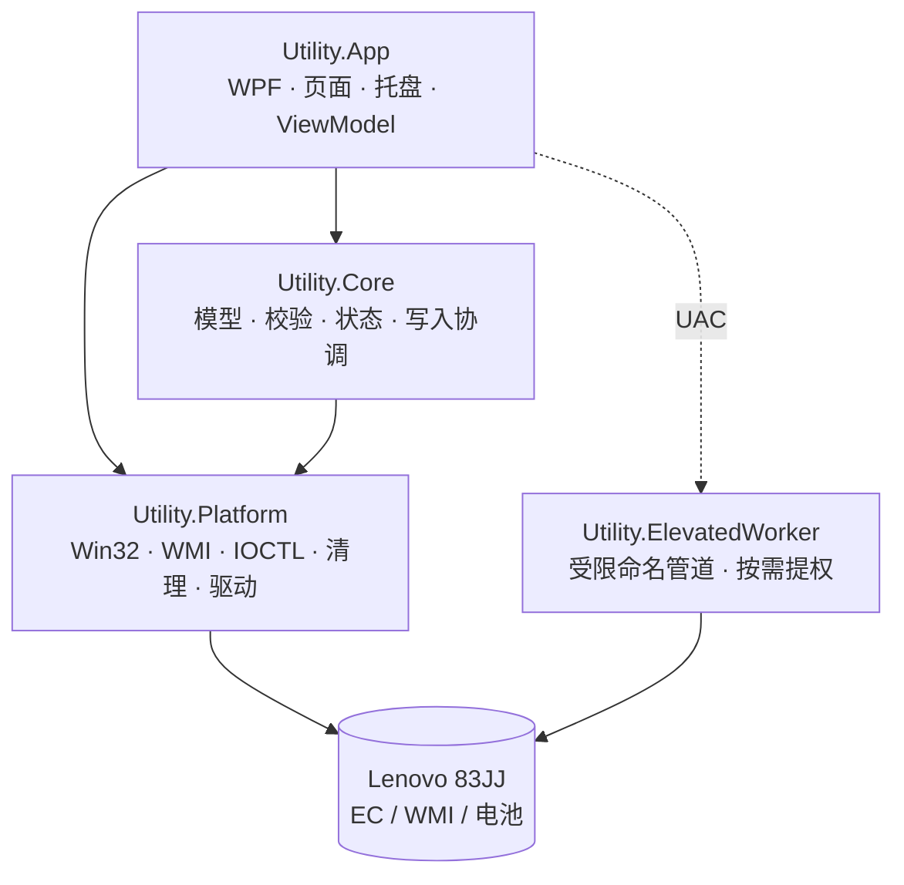

<div align="center">


<h1>Utility</h1>

<p><b>把拯救者的性能、散热与电池，收进一个干净的原生 Windows 面板。</b></p>

<p>面向 Lenovo Legion Y7000 IRX9（83JJ）的本地优先 Windows 工具箱<br />
C# · WPF · .NET 10 · 无后台服务 · 无内核驱动 · 按需提权</p>

[](https://github.com/YYHSSR/Utility)
[](https://dotnet.microsoft.com/)
[](https://github.com/YYHSSR/Utility)
[](https://github.com/YYHSSR/Utility/releases/latest)
[](LICENSE)

[功能](#功能) · [快速开始](#快速开始) · [安全设计](#安全设计) · [构建](#构建与测试) · [许可证](#许可证) · [贡献者](CONTRIBUTORS.md)

</div>

Utility 是个人项目，与 Lenovo / 联想、NVIDIA 无隶属或背书关系。厂商写入功能仅对 **83JJ + BIOS PTCN18WW** 开放；其他机型请先阅读[兼容性](#兼容性)。

---

## 为什么是 Utility

官方控制中心什么都有，但你不一定需要它的全部。Utility 只专注三件事：

- **看得清** —— CPU、GPU、内存、磁盘、电池和风扇状态集中在一页。
- **改得准** —— 每次写入先读原值，改完回读核验；失败自动回滚。
- **退得回** —— 操作日志、恢复提示、固件默认值，尽量让你有路可退。

它不安装 Windows 服务，也不加载内核驱动。主程序以普通用户运行，只有在你主动执行需要特权的操作时，才会通过独立的提权助手请求 UAC。

## 功能

|  |  |
|:---|:---|
| **📊 系统概述**<br><br>CPU、GPU、内存、磁盘、电池实时读数，近 2 分钟负载趋势；一键刷新全部状态。插电时可执行最长 30 秒的降温除尘，温度达标自动恢复原风扇控制。 | **⚡ 性能配置**<br><br>日常 / 游戏双档功耗预设。只写入两档之间有差异的字段，先降后升；写入后整表回读核验，失败自动回滚并保留操作日志。 |
| **🌀 自定义风扇**<br><br>读取 10 级固件风扇表，按通道编辑曲线并做几何校验；应用前需完成实机捕获，支持恢复固件默认值。 | **🔋 电池与显卡**<br><br>设计容量、满充容量、健康度、循环次数；联想养护模式读写与回读；独显 / 混合 / 集显路由切换，操作前需确认重启恢复路径。 |
| **🧹 垃圾清理**<br><br>一键回收闲置内存、清理两天前的临时缓存；查找重复文件和大文件，管理系统还原点。 | **📦 软件与启动项**<br><br>查看可卸载的 Win32 与 AppX 应用及启动项。卸载后扫描文件和注册表，所选残留文件永久删除，注册表删除前备份。 |
| **🛡️ 官方驱动**<br><br>对照联想 83JJ 官方目录检查更新，按硬件 ID、Windows 版本和驱动版本筛选，校验 SHA-256 与 Authenticode 后在本机安装。 | **🧪 原生与可诊断**<br><br>WPF 中文界面、高 DPI、托盘常驻；`--diagnostics-export` 可导出只读的本机能力与遥测快照，方便排查问题。 |

### 页面地图

```text
系统概述
├─ 性能与硬件
│  ├─ 性能配置
│  ├─ 自定义风扇曲线
│  └─ 电池与显卡
└─ 系统工具
   ├─ 垃圾清理
   ├─ 软件与启动项
   └─ 官方驱动
```

## 快速开始

### 方式一：下载 Windows 安装包

前往 [GitHub Releases](https://github.com/YYHSSR/Utility/releases/latest) 下载 `Utility-0.6.5-win-x64-Setup.exe`。双击安装后，从开始菜单打开 Utility。安装包包含 .NET 10 Windows Desktop Runtime。

程序安装在 `%ProgramFiles%\YYHSSR\Utility`。升级时运行新版安装包，已有配置会继续从 `%LOCALAPPDATA%\Utility` 读取。下载页提供安装包的 SHA-256 校验文件。

在当前管理员账户下，可以从管理员 PowerShell 运行以下命令，一次性授权日常的功耗、风扇和显卡控制。授权记录由任务计划程序管理，限定当前账户和 Utility 的硬件助手。

```powershell
& "$env:ProgramFiles\YYHSSR\Utility\Utility.ElevatedWorker.exe" --enable-hardware-task
```

### 方式二：从源码构建

```powershell
git clone https://github.com/YYHSSR/Utility.git
cd Utility

dotnet restore
dotnet build -c Release --no-restore
dotnet test -c Release --no-build

dotnet run --project .\src\Utility.App\Utility.App.csproj -c Release
```

发布为框架依赖的 `win-x64` 包：

```powershell
dotnet publish .\src\Utility.App\Utility.App.csproj `
  -c Release -r win-x64 --self-contained false `
  -o .\publish\win-x64
```

生成物位于 `publish\win-x64\`，双击 `Utility.exe` 即可运行。

### 运行要求

| 项目 | 要求 |
|:---|:---|
| 系统 | Windows 11 x64（当前验证环境） |
| 运行时 | 安装包自带 .NET 10 Windows Desktop Runtime。源码的框架依赖构建需要单独安装它 |
| 设备 | Lenovo Legion Y7000 IRX9（`83JJ`），BIOS `PTCN18WW`（厂商写入） |
| 权限 | 普通用户启动；写入操作按需触发 UAC |
| 其他 | 无需安装服务或驱动；关闭主窗口后默认驻留托盘 |

## 兼容性

| 设备 / 系统 | 支持情况 |
|:---|:---|
| Lenovo Legion Y7000 IRX9（`83JJ`）/ BIOS `PTCN18WW` / Windows 11 x64 | ✅ 厂商写入功能的验证目标 |
| 其他 Lenovo Legion 机型 | ⚠️ 通用只读功能可用；厂商写入受目标校验限制，未验证 |
| 非 Lenovo 设备 | 清理、软件管理等通用功能可用 |
| Windows 10 / ARM64 / 32 位 | ❓ 未验证；项目仅发布 `win-x64` |

> 硬件写入不是“能读到就一定能安全写入”。未在目标机型与 BIOS 上验证的写入路径会被拒绝，这是有意设计，不是功能缺失。

## 安全设计

| 原则 | 实现 |
|:---|:---|
| **最小权限** | 主程序以普通用户运行。特权操作由独立助手执行，支持针对当前管理员账户单独授权日常硬件控制。 |
| **受限提权通道** | ACL 限制的命名管道、双方进程 ID 校验、一次性 token，并排除网络客户端。 |
| **写入可逆** | 先读原值，只写差异字段，完成后整表回读；失败回滚，中断操作通过 journal 在下次启动时提示恢复。 |
| **目标锁定** | 性能、风扇、显卡与养护模式写入仅对 `83JJ` + `PTCN18WW` 开放，避免误刷其他机型。 |
| **驱动更新** | 点击安装后请求管理员权限。新驱动生效并确认旧包已脱离设备后，使用 Windows 工具清除旧包。 |
| **清理确认** | 卸载残留窗口列出待清理项目。点击清理后永久删除所选文件，注册表删除前备份。 |
| **测试隔离** | xUnit 测试使用模拟硬件提供者，自动化测试不会写入真实硬件。 |
| **无后台组件** | 不安装 Windows 服务或内核驱动；托盘常驻，可从托盘菜单完全退出。 |

## 架构



### 仓库结构

| 路径 | 内容 |
|:---|:---|
| `src/Utility.App/` | WPF 主程序、页面、ViewModel、托盘与本地化资源 |
| `src/Utility.Core/` | 领域模型、配置校验、状态持久化、写入协调 |
| `src/Utility.Platform/` | Win32 / WMI / IOCTL、联想适配、清理与驱动清单 |
| `src/Utility.ElevatedWorker/` | 受限提权助手，仅接受类型化操作请求 |
| `tests/Utility.Tests/` | xUnit 测试与模拟硬件提供者 |
| `docs/` | 架构说明与目标机能力报告 |
| `assets/` | 图标源文件与多尺寸 `.ico` |
| `installer/` | Inno Setup 安装器定义 |
| `scripts/` | 安装包构建与图标生成脚本 |

## 构建与测试

| 层 | 技术 |
|:---|:---|
| UI | WPF / XAML |
| 运行时 | .NET 10（`net10.0-windows`，`win-x64`） |
| 系统接口 | Win32 P/Invoke、WMI、EnergyDrv IOCTL、命名管道 |
| 测试 | xUnit + 模拟硬件提供者 |
| 发布 | `dotnet publish`，框架依赖 / 自包含均可 |

完整验证命令：

```powershell
dotnet --list-sdks
dotnet restore
dotnet build -c Release --no-restore
dotnet test -c Release --no-build --verbosity normal
dotnet publish .\src\Utility.App\Utility.App.csproj `
  -c Release -r win-x64 --self-contained false `
  -o .\publish\win-x64
```

### 构建 Windows 安装包

构建电脑需要 .NET 10 SDK、Inno Setup 7 和 MinGW-w64 x64 GCC。在仓库根目录运行，并按实际安装位置填写两个编译器路径。

```powershell
.\scripts\Build-Installer.ps1 -InnoCompiler 'C:\Tools\Inno Setup\ISCC.exe' -HardwareLauncherCompiler 'C:\msys64\ucrt64\bin\gcc.exe'
```

安装包和 SHA-256 校验文件输出到 `publish\`。

### 只读诊断导出

需要在不改动机器状态的前提下收集信息时：

```powershell
.\publish\win-x64\Utility.exe --diagnostics-export "$env:TEMP\utility-diagnostics.json"
```

该命令以普通用户运行，导出能力与遥测快照后退出。

### 数据与卸载

- 设置、日志和操作记录位于 `%LOCALAPPDATA%\Utility\`。
- 在 Windows 的「设置 → 应用 → 已安装的应用」中卸载 Utility。卸载后配置和操作记录仍保留在用户目录，确认不再使用时可手动删除。
- 项目不包含账号系统或自建遥测。驱动检测使用公开的联想型号目录，硬件 ID 和版本比对在本机完成。

## 常见问题

<details>
<summary><b>为什么只有 83JJ 能写硬件？</b></summary>

联想 WMI 与 EnergyDrv 的接口、字段含义和单位会随机型与 BIOS 版本变化。未验证的写入可能造成风扇失控、功耗异常或无法启动。Utility 只对已验证的目标开放写入，其他机型保留只读能力。
</details>

<details>
<summary><b>会和 Legion Zone / 联想电脑管家冲突吗？</b></summary>

建议不要同时执行写入操作。部分性能与风扇功能需要以联想自定义模式为基线，运行前请确认当前模式，并保留官方的恢复路径。
</details>

<details>
<summary><b>关闭窗口后程序还在运行？</b></summary>

默认关闭到托盘，这是为了方便查看状态。右键托盘图标选择“退出 Utility”即可完全结束进程。
</details>

<details>
<summary><b>这是开源软件吗？</b></summary>

源码公开，但**不是 OSI 认可的开源许可证**。本项目采用非商业共享许可证：允许个人学习、修改与非商业转发，禁止商业使用。详见[许可证](#许可证)。
</details>

## 贡献

欢迎提交 Issue 和 Pull Request。

- 提交 PR 前，建议先开 Issue 说明改动目的和验证方式。
- 请勿提交你无权授权的代码、图标或其他资源。
- 提交的贡献视为同意以本项目的许可证发布。
- 涉及硬件写入的改动，请说明目标机型、BIOS 版本、回读结果与恢复方案。
- 安全漏洞请先与作者私下联系，不要在公开 Issue 中披露可利用细节。

## 许可证

本项目采用 **Utility 非商业共享许可证 1.0（UNCSL-1.0）**。

[](LICENSE)

| 你可以 | 你必须 | 你不可以 |
|:---|:---|:---|
| 个人使用、学习、研究、教学 | 保留版权声明与许可证 | 出售、出租、付费分发 |
| Fork、修改、二次创作 | 显著注明来源与作者 | 用于商业产品或商业服务 |
| 非商业转发原版或二创 | 二创继续使用同一许可证 | 设置付费墙或捆绑销售 |
| 分享给朋友 | 标注修改内容与日期 | 暗示作者为你背书 |

完整条款以 [LICENSE](LICENSE) 为准。

### 转发 / 二创署名模板

```text
本项目基于 YYHSSR/Utility（https://github.com/YYHSSR/Utility）修改。
原项目采用 Utility 非商业共享许可证 1.0（UNCSL-1.0）。
修改内容：……
修改日期：……
```

### 商业授权

本许可证不允许商业使用。如需将 Utility 或其代码用于商业项目，请通过 GitHub 联系 [@YYHSSR](https://github.com/YYHSSR) 获取书面授权。

> 源码公开是为了方便审阅、学习与非商业二创，并不改变许可证对商业使用的限制。

## 致谢与商标

感谢所有公开分享 Legion 固件接口、Win32 电源管理与 WPF 实践资料的开发者。

Lenovo、Legion 是联想集团的商标；NVIDIA、RTX 是 NVIDIA 公司的商标；Windows 是 Microsoft 的商标。本项目与上述公司无隶属、合作或背书关系。

## 免责声明

本软件按“现状”提供，不附带任何明示或暗示的担保。硬件写入有风险，请在使用前备份重要数据、接通电源，并确认设备型号与恢复路径。因使用本软件造成的任何直接或间接损失，由使用者自行承担。

---

<div align="center">

如果 Utility 让你的拯救者更安静一点，点个 ⭐ 支持一下。

Made with care by [YYHSSR](https://github.com/YYHSSR)

</div>
